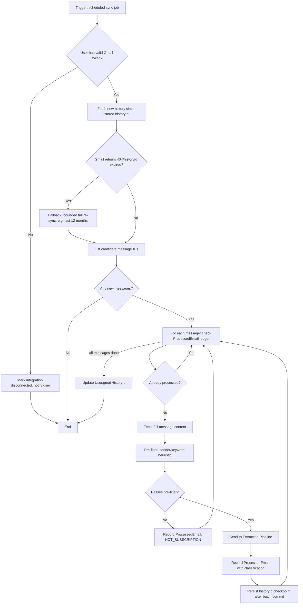
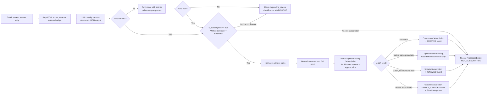
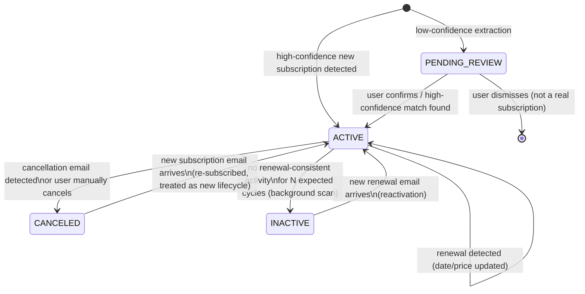

# Subscription Tracking Agent — Technical Design

*Phase 2 output, per [subscription-tracking-agent-prompts.md](../subscription-tracking-agent-prompts.md). Builds on the approved architecture in [docs/architecture.md](architecture.md).*

---

## 1. Database Schema (Prisma)

```prisma
enum SubscriptionStatus {
  ACTIVE
  CANCELED
  INACTIVE
  PENDING_REVIEW
}

enum BillingCycle {
  WEEKLY
  MONTHLY
  ANNUAL
  CUSTOM
}

enum EventType {
  CREATED
  RENEWED
  PRICE_CHANGED
  CANCELED
  FLAGGED_INACTIVE
  REACTIVATED
}

enum EmailClassification {
  SUBSCRIPTION
  NOT_SUBSCRIPTION
  AMBIGUOUS
}

model User {
  id                String         @id @default(cuid())
  email             String         @unique
  gmailRefreshToken String?        // encrypted at the application layer before storage
  gmailHistoryId    String?        // Gmail sync checkpoint
  gmailConnected    Boolean        @default(false)
  createdAt         DateTime       @default(now())
  updatedAt         DateTime       @updatedAt

  subscriptions     Subscription[]
  processedEmails   ProcessedEmail[]
  auditLogs         AuditLog[]
}

model Subscription {
  id                 String             @id @default(cuid())
  userId             String
  user               User               @relation(fields: [userId], references: [id])

  vendorNormalized   String
  vendorRaw          String
  status             SubscriptionStatus @default(ACTIVE)

  priceAmountCents   Int
  priceCurrency      String             // ISO 4217
  billingCycle       BillingCycle

  nextRenewalDate    DateTime?
  lastSeenEmailId    String?
  confidenceScore    Float

  createdAt          DateTime           @default(now())
  updatedAt          DateTime           @updatedAt

  events             SubscriptionEvent[]
  priceChanges       PriceChange[]

  @@index([userId, status])
  @@index([userId, vendorNormalized])
  @@index([userId, nextRenewalDate])
}

model SubscriptionEvent {
  id             String       @id @default(cuid())
  subscriptionId String
  subscription   Subscription @relation(fields: [subscriptionId], references: [id])

  eventType      EventType
  sourceEmailId  String?
  payload        Json         // extraction snapshot at time of event

  createdAt      DateTime     @default(now())

  @@index([subscriptionId, createdAt])
}

model PriceChange {
  id             String       @id @default(cuid())
  subscriptionId String
  subscription   Subscription @relation(fields: [subscriptionId], references: [id])

  oldAmountCents Int
  newAmountCents Int
  currency       String

  detectedAt     DateTime     @default(now())
  sourceEmailId  String?

  @@index([subscriptionId, detectedAt])
}

model ProcessedEmail {
  id               String               @id @default(cuid())
  userId           String
  user             User                 @relation(fields: [userId], references: [id])

  gmailMessageId   String
  gmailHistoryId   String
  classification   EmailClassification
  processedAt      DateTime             @default(now())

  @@unique([userId, gmailMessageId])
  @@index([userId, processedAt])
}

model AuditLog {
  id        String   @id @default(cuid())
  userId    String
  user      User     @relation(fields: [userId], references: [id])

  action    String
  actor     String   // "system" | "user"
  details   Json

  createdAt DateTime @default(now())

  @@index([userId, createdAt])
}
```

Notes:
- Money stored as `Int` cents (`priceAmountCents`) — never `Float`.
- `ProcessedEmail` has a compound unique constraint `(userId, gmailMessageId)`, which is the hard idempotency guarantee referenced in the architecture doc.
- `SubscriptionEvent.payload` retains the raw extraction result for that event so history is reconstructable without re-deriving from email.

---

## 2. Gmail Processing Workflow



Key properties:
- The `historyId` checkpoint is only advanced **after** a batch of messages successfully commits — a crash mid-batch resumes from the last committed checkpoint rather than reprocessing everything or silently skipping messages.
- Rate-limit (429) handling wraps every Gmail API call (`C`, `E`, `I`) with exponential backoff + jitter, respecting `Retry-After`; not drawn per-node to keep the diagram readable.

---

## 3. Subscription Extraction Pipeline



Extraction output schema (LLM-facing contract):

```json
{
  "is_subscription": true,
  "vendor": "Netflix",
  "price": { "amount": 15.49, "currency": "USD" },
  "billing_cycle": "monthly",
  "renewal_date": "2026-10-02",
  "confidence": 0.94
}
```

Validation rules applied after the LLM call (deterministic, not LLM-trusted):
- `confidence` must be a float in `[0, 1]`; anything outside range is treated as `0` (forces review).
- `price.amount` must be a positive number; `currency` must be a valid ISO 4217 code, else routed to review.
- `renewal_date`, if present, must parse as a valid future-or-recent date; implausible dates (e.g., >5 years out) are flagged, not trusted.
- The email body is passed to the LLM strictly as a data field inside a fixed prompt template — the model is never given tool/action capability, so even a successful injection can at most corrupt the JSON output (which validation then catches or routes to review), not trigger a side effect.

---

## 4. State Machine — Subscription Lifecycle



Transition rules:
- `PENDING_REVIEW` is only ever entered from a fresh extraction below the confidence threshold — it never overwrites an existing `ACTIVE` subscription's state without explicit resolution.
- `ACTIVE → INACTIVE` is driven by the Alert Scheduler (Section 5), not the extraction pipeline — it's a time-based background judgment, not an email-triggered one.
- `CANCELED → ACTIVE` is modeled as a fresh lifecycle (new `SubscriptionEvent: CREATED`) rather than a `REACTIVATED` event on the old record, since a cancel-then-resubscribe often carries a new price/plan.

---

## 5. Alert Scheduling Mechanism

```mermaid
flowchart TD
    subgraph Recurring Jobs
        A[Renewal Reminder Job\nruns daily] --> A1[Query subscriptions where\nnextRenewalDate in [now, now+7d]\nand status=ACTIVE]
        A1 --> A2[Emit notification per subscription\nidempotent: one per renewal cycle]

        B[Price Increase Job] --> B1[Triggered inline by extraction pipeline\non PRICE_CHANGED event, not polled]
        B1 --> B2[Emit notification immediately]

        C[Inactivity Scan Job\nruns weekly] --> C1[Query ACTIVE subscriptions where\nnextRenewalDate < now - grace period\nand no renewal event since]
        C1 --> C2[Transition to INACTIVE\n+ emit notification]
    end

    A2 --> D[Notification Feed / API]
    B2 --> D
    C2 --> D
    D --> E[Dashboard + optional email digest]
```

Design notes:
- Renewal reminders and inactivity scans are **polling jobs** (daily/weekly cron) since they're time-based judgments over existing data.
- Price-increase alerts are **event-driven**, fired directly when the extraction pipeline records a `PRICE_CHANGED` event — no need to wait for the next poll.
- All jobs are idempotent per `(subscription_id, alert_type, cycle)` to survive job overlap/retries; combined with the per-user advisory lock from the architecture doc, this prevents duplicate notifications.

---

## 6. Entity Extraction Strategy

- **Single-pass LLM call per email**, combining classification (`is_subscription`) and extraction in one structured-output request — avoids a separate classify-then-extract round trip for the common case, reducing cost per Architecture Review finding #2.
- **Pre-filter before LLM**: a cheap, deterministic heuristic (sender domain patterns, subject/snippet keyword match) eliminates the majority of non-subscription mail before it incurs any LLM cost. This is the primary cost-control lever.
- **Prompt structure**: fixed system prompt + fixed output schema; email content injected only as a clearly delimited data field, never concatenated into instruction text — the concrete mechanism for the prompt-injection concern raised in the architecture review (finding #3).
- **Confidence calibration**: rather than trusting the LLM's self-reported confidence in isolation, confidence is adjusted by deterministic signals (e.g., known-vendor domain match boosts confidence, missing/unparseable price or date caps confidence below the auto-apply threshold). Reduces reliance on an uncalibrated model signal (review finding #9).
- **Vendor normalization strategy**: exact-match lookup table first; fuzzy match (e.g., trigram similarity) only as a fallback, and any fuzzy match below a similarity threshold is routed to `pending_review` rather than auto-merged (review finding #4) — never silently merges two vendors.
- **Currency extraction**: parsed from explicit currency symbols/codes in the email; if absent, defaults to the user's Gmail account locale/country as a heuristic, but is marked low-confidence and eligible for review rather than silently assumed.

---

## Open Items Carried Into Implementation

These map directly to review findings from Phase 1 that this technical design resolves or explicitly defers:

| Review finding | Resolution in this design |
|---|---|
| #2 LLM cost not bounded | Pre-filter before LLM call; single-pass classify+extract |
| #3 Prompt injection needs a concrete mechanism | Fixed prompt template, email content as delimited data only, no tool/action capability given to the model |
| #4 Vendor merge conflict resolution | Fuzzy-match threshold routes to `pending_review` instead of auto-merge |
| #9 Confidence score calibration | Deterministic signal adjustments layered on top of LLM-reported confidence |
| #5 No resolution workflow for `pending_review` | **Resolved in Phase 3** — review queue UI (`/reviews`) plus `GET /api/reviews`, `POST /api/reviews/:id/confirm`, and `POST /api/reviews/:id/dismiss`. Confirm can include field edits; dismiss is a terminal `DISMISSED` status with an append-only `ReviewDecision`. |
| #6 Mixed-currency reporting guard | **Resolved in Phase 3, extended 2026-11 with FX conversion** — native amounts are still never added across ISO 4217 codes: `summarizeSpend` and `GET /api/reports/spend` always return per-currency totals in `byCurrency`. When stored exchange rates allow it, a mixed-currency summary also carries an approximate `converted` total in the user's display currency; otherwise it keeps `MIXED_CURRENCY_NO_FX`. Since 2026-11-10 every total is a **monthly equivalent** (`period: "monthly"`): annual and weekly plans are converted to a monthly cost first, and custom/unknown cycles are left out and counted in `excludedCount`. See "Monthly spend total" and "Currency conversion for the spend total" below. |

## Monthly spend total

**Goal.** The Dashboard and `GET /api/reports/spend` show what the user pays per month. Before 2026-11-10 the total added each price as stored, so an annual plan counted at its full yearly price.

**Rule** (`monthlyEquivalentCents` in `src/application/reporting/spend-summary.service.ts`), applied to each ACTIVE or INACTIVE subscription before anything is added:

| `billingCycle` | Monthly equivalent |
|---|---|
| `MONTHLY` | the price as stored |
| `ANNUAL` | price ÷ 12 |
| `WEEKLY` | price × 52 ÷ 12 |
| `CUSTOM` (also how the API's `unknown` is stored) | none: left out of every total and counted in `excludedCount` |

A cycle is never guessed. A value the code does not recognise is treated like `CUSTOM`.

**Rounding.** Each subscription's monthly equivalent is rounded **half-up to a whole minor unit on its own, before adding** (integer arithmetic, no floating point). The total is therefore the sum of per-item figures that can be checked by hand; it can differ by a cent or two from dividing the summed annual prices once. Example: annual plans of 499.00, 36.00, 85.90 and 85.00 give 41.58 + 3.00 + 7.16 + 7.08 = 58.82 a month.

**Response.** Both shapes of the summary carry `period: "monthly"` and `excludedCount`. The existing field names (`totalCents`, `subscriptionCount`, `byCurrency`, `converted`) are unchanged, but their amounts are now monthly, and `subscriptionCount` counts only the subscriptions included in the total. An excluded subscription does not count towards "mixed currency" either. When nothing can be counted the total is 0 in the currency of the user's first reportable subscription (USD if there is none).

**Stored data is untouched.** Prices and billing cycles are stored as before. The Subscriptions list, Calendar, `.ics` and CSV keep showing each plan's own price per its own cycle.

**Dashboard.** The spend card is titled "Spend per month", every amount says "per month", and when `excludedCount > 0` it says how many subscriptions were not included.

**Not done.** A yearly view of the same total.
| #7 Retention/deletion policy | **Partially addressed in Phase 3** — `EmailSnapshot.expiresAt` plus a daily purge job, and cascading deletes on user removal. A documented GDPR TTL/right-to-erasure policy is still required before Phase 8. |

## Currency conversion for the spend total (review finding #6)

**Goal.** A user whose subscriptions are billed in several currencies sees one approximate total in their display currency, next to the unchanged per-currency breakdown, labelled with the date of the rates used. Stored subscription amounts are never changed.

**Source.** [Frankfurter](https://frankfurter.dev/) (`FX_API_BASE_URL`, default `https://api.frankfurter.dev`): free, no API key, daily central-bank reference rates, open source and self-hostable. It sits behind the `FxRateProvider` port (`src/domain/ports.ts`); `FrankfurterRateProvider` and a `FakeFxRateProvider` for tests live in `src/infrastructure/fx/`. The request is `GET /v2/rates?base=<base>`, and the only thing sent is the base currency code. No user data, amounts or vendors leave the app. The provider filters the response to the currencies wanted rather than sending a `quotes` list, because Frankfurter rejects the whole request when any one requested code is unknown to it.

**Daily job.** `FxRateJob` (`src/application/fx/fx-rate.job.ts`) runs in the worker at 05:30 and once at worker start (`npm run fx:refresh` runs it by hand, and `start-app.bat` does so on every start). It collects the currencies on active/inactive subscriptions, every user's display currency and the fixed list of display options, fetches the latest rates against the base currency (`DEFAULT_DISPLAY_CURRENCY`), validates each row (requested pair, positive finite rate, real date) and upserts one row per pair into `ExchangeRate`. If the provider is down, the previous rows stay untouched.

**Requests never call the provider.** `SubscriptionService.spendSummary` reads only the stored `ExchangeRate` rows. A provider outage cannot slow down or break the dashboard or the API.

**Display currency.** A per-user setting (`User.displayCurrency`, set on the settings page via `PATCH /api/account`) with a config default (`DEFAULT_DISPLAY_CURRENCY`, default `ILS`) used while the column is null. Choices are limited to `DISPLAY_CURRENCY_OPTIONS` (`src/shared/display-currencies.ts`); the job always keeps rates for all of them, so a change takes effect at once.

**Response shape** (`GET /api/reports/spend`, mixed-currency case):

```json
{
  "summary": {
    "period": "monthly",
    "excludedCount": 0,
    "mixed": true,
    "byCurrency": [
      { "currency": "ILS", "totalCents": 5990, "subscriptionCount": 1 },
      { "currency": "USD", "totalCents": 1000, "subscriptionCount": 1 }
    ],
    "converted": {
      "currency": "ILS",
      "totalCents": 9990,
      "rateDate": "2026-11-09",
      "source": "frankfurter",
      "approximate": true
    }
  }
}
```

`byCurrency` holds the per-currency monthly totals in native currency, and `converted` is built from those same monthly totals, so it is a monthly figure too. The single-currency shape (`mixed: false`) is never converted.

**Never silently wrong.** Conversion is all-or-nothing. If any currency involved has no stored rate (`fxUnavailable: "RATE_MISSING"`), or its rate is older than `FX_MAX_RATE_AGE_DAYS` (default 7, which covers weekends and holidays; `fxUnavailable: "RATE_STALE"`), `converted` is omitted and the summary keeps `warning: "MIXED_CURRENCY_NO_FX"`, exactly as before this feature. `rateDate` is the oldest publication date among the rates used, so the label never overstates freshness.

**Rounding.** Amounts are integer minor units end to end. Each currency's subtotal is converted on its own and rounded half-up to the display currency's minor unit (respecting currencies such as JPY that have none), then the rounded subtotals are added. A currency that is not the base is converted through the base (cross rate). The dashboard marks the result with "≈" and the rate date.

**Out of scope.** Historical rates per charge date, the Bank of Israel as a source, and converting single-currency summaries. (Normalising billing cycles was out of scope here and was added on 2026-11-10: see "Monthly spend total" above.)
